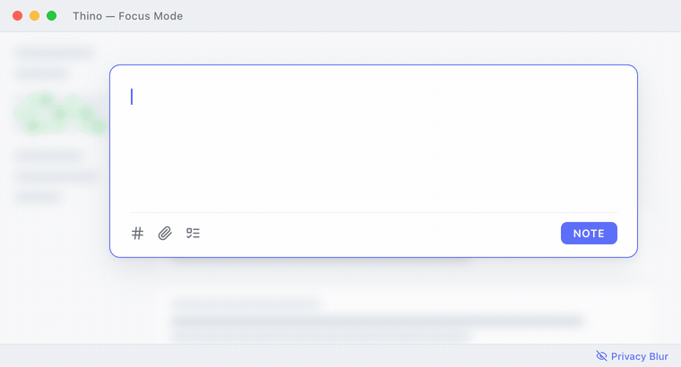

# Thino Privacy Blur

[English](README.md) | [简体中文](README.zh-CN.md)

Automatically blur previously typed content while writing in [Thino](https://github.com/Quorafind/Obsidian-Thino) and reveal it smoothly only on intentional mouse hover.

## Features

- **Automatic typing privacy**: Blurs previous lines and earlier text on the current line while keeping a configurable clear tail before the cursor.
- **Intentional hover reveal**: Reveals only the hovered clause or line when moving the pointer onto blurred text; ignores stationary cursors, micro-jitter, and trailing blank space.
- **Idle & focus-loss protection**: Automatically blurs remaining text after pausing typing or switching away from the editor/window.
- **Thino-native & safe**: Works in main views, Focus mode, and popout windows without modifying Thino or normal Markdown notes; CJK IME safe.

## Installation

1. Install **Thino Privacy Blur** from Obsidian **Settings → Community plugins → Browse** (once listed), or download `main.js`, `manifest.json`, and `styles.css` from [Releases](https://github.com/shiluanzzz/thino-privacy-blur/releases).
2. Enable **Thino Privacy Blur** in Obsidian Settings. Use the eye icon in the status bar or Command Palette (`Toggle privacy blur`) to pause/resume anytime.

## Project Docs

- [PROJECT.md](PROJECT.md) · [INDEX.md](INDEX.md) · [AGENTS.md](AGENTS.md) · [Release Guide](docs/operations/obsidian-community-release.md)
