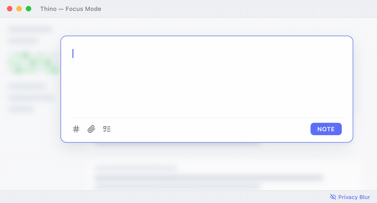

# Thino Privacy Blur

[English](README.md) | [简体中文](README.zh-CN.md)

在 Obsidian 的 [Thino](https://github.com/Quorafind/Obsidian-Thino) 中输入时，自动模糊已经输出的内容；仅当鼠标主动移到前面的文字上时局部清晰显示，适合办公室等公共场景防窥。

## 核心特性

- **边输入边自动模糊**：已换行的前序内容（含图片、嵌入块与任务复选框）以及当前行光标前超出保留字数的已输入内容自动模糊，仅保留光标前最后几个字清晰可见。
- **鼠标主动悬停才清晰**：鼠标移到模糊文字上时，仅平滑显示该句（或该行），跨加粗、`#标签`、`[[链接]]` 整句同步清晰；不会因静止鼠标、桌面微抖或行尾空白区误触发。
- **停顿与切窗全模糊兜底**：停止输入超过设定秒数，或切走窗口 / 点击其他区域时，连尾部清晰区也立即模糊并清除悬停显示。
- **原生兼容、零侵入**：支持 Thino 普通视图、Focus 模式与独立弹出窗口；中文输入法（IME）拼写候选期间不打断；不修改 Thino 本体，也不影响普通 Markdown 笔记。

## 安装与使用

1. 上架后可在 Obsidian **设置 → 第三方插件 → 社区插件市场** 搜索 **Thino Privacy Blur** 安装；或从 [Releases](https://github.com/shiluanzzz/thino-privacy-blur/releases) 下载 `main.js`、`manifest.json`、`styles.css` 放入 `<vault>/.obsidian/plugins/thino-privacy-blur/`。
2. 启用插件后立即在 Thino 中生效；可通过右下角状态栏眼睛图标或命令面板（`切换 Thino 输入防窥模糊`）随时暂停/恢复。
3. 在 **设置 → 第三方插件 → Thino Privacy Blur** 中可调整：是否仅在 Focus 模式生效、光标前保留清晰字数（默认 6）、模糊强度（默认 `5px`）、停顿全模糊延迟（默认 3 秒）、失焦立即全模糊以及悬停显示粒度（按句 / 按整行）。

## 项目文档

- [PROJECT.md](PROJECT.md)：项目现状、当前能力、待办与踩坑经验。
- [Obsidian 社区发布指引](docs/operations/obsidian-community-release.md)：GitHub Release 与提交 `obsidian-releases` 清单。
- [INDEX.md](INDEX.md)：全仓文档扁平导航。
- [AGENTS.md](AGENTS.md)：仓库协作规则与发布边界。
